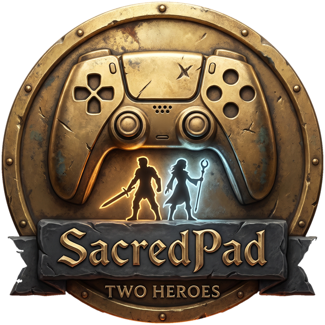
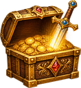

<p align="center"></p>

# SacredPad: Two Heroes

**Couch co-op and a complete controller overhaul for Sacred Gold.**

<table align="center">
  <tr>
    <td align="center" width="200"><br><b>Two heroes</b><br>on one screen, with two controllers</td>
    <td align="center" width="200"><br><b>The whole game on the pad</b><br>fights, inventory, shops, menus</td>
    <td align="center" width="200"><br><b>Shared adventure</b><br>two inventories, loot, quest rewards</td>
  </tr>
</table>

Play Sacred Gold with a controller, alone or with a friend on the same PC: two heroes, two pads, one screen.
Made for the couch, the Steam Deck and the Steam Machine.

SacredPad is a 32-bit `version.dll` that goes next to `Sacred.exe`. The game loads it instead of the Windows one, and
SacredPad passes every call on to the real `version.dll`. It does not change any game file: delete the DLL and the game
is exactly as before. Mouse and keyboard keep working; as soon as you touch the mouse the mod steps aside.

> **Beta.** This is the first public release. Everything below works on the author's PC (Windows 11) and Steam Machine
> (SteamOS, Proton), but it has been tested by one person. Please report what goes wrong: see [TESTING.md](TESTING.md).

*Italiano: [più sotto](#italiano).*

## What it does

### The controller

The whole game is played from the pad, not just moved around:

- Move with the left stick; doors open when you walk into them, portals when you walk into them.
- **A** attacks and interacts. The target is chosen for you: the best enemy in the direction of the right stick, the left
  stick or your last movement. Standing still, the pointer rests on what A would pick and the game highlights it. With
  no enemies around, A talks to the nearest character, opens the nearest chest, picks up the nearest item; press A
  again to move on to the next one.
- Combat arts on **X, Y, RB, RT, LT** (the five slots of the taskbar), healing potion on **LB**, two more potions on
  the D-pad (hold for zoom), weapon sets on D-pad left/right, minimap on the left stick click, item names on the right
  stick click, pick up all on **B** (hold: call, mount or leave your horse).
- **Cursor mode** for inventory, shops, chests, dialogues and menus: it turns on by itself when a window opens. Left
  stick moves the game's own cursor, right stick moves it slowly, the D-pad jumps between slots and buttons, A and B are
  left and right click, LB/RB change tab, Y closes. In dialogues A accepts and B declines.
- Button symbols on the arts and potions of the taskbar (Xbox, PlayStation or Steam style).
- An in-game help with a picture of your controller: hold **Menu**.
- Rumble when your hero's portrait flashes red.

Full list: [docs/CONTROLS.md](docs/CONTROLS.md).

### Two heroes on one screen

Sacred never had local co-op. SacredPad adds it inside the same game, on the same screen:

- **Two players** in the main menu: pick hero 2 among your saved heroes, then start or load a campaign as usual.
  Hero 2 joins with the second controller and the same controls as player 1.
- Shared camera on the middle point between the heroes, a ring at each hero's feet, an arrow when one is off screen.
- Hero 2 has a taskbar of its own (arts, potions, weapons), portrait, name bar, experience, levels and skill points.
- **Two inventories side by side**, each player with their own game cursor and their own hand: both can drag items at the
  same time, and drop items into the other hero's backpack.
- Shared merchant and shared chest in two columns: each player buys, sells and stores for their own hero. The combo
  master works for both; the blacksmith serves one player at a time.
- Shared experience, gold, map and healing arts. Loot and shop goods are split between the two classes. Quest rewards
  come for hero 2 too (on the ground next to hero 2), and so do quest attribute and skill points.
- Revive: a hero who falls gets back up when the other one stays close, or alone after a while.
- Companions: see and change their equipment from your column, they gain experience and can use items of any class.
- Hero 2 is saved in their own hero file every time you save, so you can take them to another campaign or play them alone.

There is also an experimental **split screen**: two game windows of 1280x720, one controller each. It needs:

- a screen at least **2560 pixels wide** (for example 2560x1440): on a narrower one the two windows overlap, and the
  "Two players" menu says so on the split screen row (same screen co-op works at any resolution);
- a full copy of the game folder next to it, with ` P2` added to the name (for example `Sacred Gold P2`), for the
  second window; the mod starts that one by itself. On Proton, set the copy to windowed (run `Config.exe` of the copy
  from Steam, full screen off).

Tested on Windows and on the Steam Machine at 2560x1440.

## Requirements

- **Sacred Gold** (Steam or GOG).
- **pureHD**, with its `pureHD.exe` used as `Sacred.exe`. SacredPad reads the game's memory, and memory addresses are
  different in every build of the executable. It was made on the `pureHD.exe` of the
  [Sacred Oro HD ITA](https://www.nexusmods.com/sacred/mods/49) package (pureHD 1.20, build 2.0.2.118, file version
  2.28; SHA-256 of the 4 GB-patched file `0a069f127962df062eb60839dbed24fbf926e8c9680c4a986860a0acd4ddca6e`). The game
  language does not matter: Italian and English were tested.
- With any other `Sacred.exe` (the original Steam/GOG one, other pureHD releases, ReBorn, NL) SacredPad tells you in a
  window at start, and only the basic controller works (moving, clicking, arts, potions, cursor). Support for the
  original Steam/GOG executable is the main goal of version 1.0.
- An XInput controller (Xbox), or any controller through Steam Input (DualSense, Steam Controller, Steam Deck). Two
  controllers for two players.

## Install

1. Download the latest `SacredPad-<version>.zip` from [Releases](https://github.com/brig-dev/SacredPad-TwoHeroes/releases)
   (or from the Nexus Mods page).
2. Copy `version.dll` and `SacredPad.ini` into the game folder, next to `Sacred.exe` (for Steam:
   `Steam\steamapps\common\Sacred Gold`).
3. **Steam Deck, Steam Machine, Linux (Proton)** only: in Steam, Sacred Gold > Properties > General > Launch options:

   ```
   WINEDLLOVERRIDES="version=n,b" %command%
   ```

   If you also use dgVoodoo and IndirectSound (as in the HD package), use instead:

   ```
   WINEDLLOVERRIDES="ddraw=n,b;d3dimm=n,b;d3d8=n,b;d3d9=n,b;dsound=n,b;version=n,b" %command%
   ```

4. Start the game. In the main menu you see "SacredPad 0.9.0" at the top and a **Two players** entry.

To uninstall, delete `version.dll` and `SacredPad.ini` (and the launch options).

### Playing with two

1. Create the hero for player 2 once, alone: new campaign, save, quit to the menu. (Any hero you already have works too.)
2. Connect both controllers. Main menu > **Two players** > choose hero 2.
3. Start or load the campaign of player 1. Hero 2 appears next to hero 1.

Hero 2's progress is saved in their own hero file whenever you save; a backup of the previous file goes to
`Save\SacredPad_backup`.

## Known issues

- Only the executable described above enables the full mod (see Requirements).
- Do not use it together with other controller mods for Sacred (for example sacred-pad or Controller Mode): two mods
  driving the same controller get in each other's way.
- The blacksmith serves one player at a time.
- Quests are written for one hero: rewards for hero 2 are added by the mod, but a quest could still behave oddly.
- Attacks of player 2 may sometimes be cut short when both players attack the same enemy.
- No online or LAN multiplayer with the mod: it is for local play.
- Tested on Windows 11 and on SteamOS with Proton; Italian and English game languages.
- The log is written in Italian. It is fine: send it as it is.

## Logs

`SacredPad.log`, next to `Sacred.exe`, is the log of the latest session. At every start the previous one moves to the
`SacredPad_log` folder with its date and time in the name, and the newest 50 are kept (`[Log] Keep` in the ini). Your
Windows user folder is never written in it. See [TESTING.md](TESTING.md) for what to send.

## Reporting problems and testing

Testers are very welcome. What to try and how to send the log: [TESTING.md](TESTING.md). Issues here on GitHub, or the
comments on Nexus Mods.

## Credits

- Made by **brig-dev**, with the help of Claude (Anthropic), which did most of the analysis of the game and wrote most
  of the code under brig-dev's direction and testing. The logo and the icons of this page were made with AI image
  tools; they contain nothing of the game.
- pureHD by Vitaly (William) Tokarev; Sacred Oro HD ITA by campi6277; dgVoodoo 2 by Dege; IndirectSound. SacredPad
  contains none of their files.
- Sacred is a game by Ascaron Entertainment; the rights belong to THQ Nordic / Deep Silver. SacredPad is an unofficial
  fan project, not affiliated with or endorsed by them, and it contains no game files.

## Support

SacredPad is and will stay free. If you want to say thanks, a coffee: [ko-fi.com/brigdev](https://ko-fi.com/brigdev).

## License

[MIT](LICENSE).

---

## Italiano

**SacredPad: Two Heroes** porta in Sacred Gold il controller completo e la co-op in due sullo stesso schermo.

Cosa serve: Sacred Gold (Steam o GOG) con il `pureHD.exe` del pacchetto
[Sacred Oro HD ITA](https://www.nexusmods.com/sacred/mods/49) al posto di `Sacred.exe` (vedi Requirements qui sopra);
con un altro eseguibile la mod lo dice in una finestra all'avvio e resta solo il controller di base.

Installazione: copia `version.dll` e `SacredPad.ini` nella cartella del gioco, accanto a `Sacred.exe`. Su Steam Deck e
Steam Machine aggiungi nelle opzioni di avvio di Steam `WINEDLLOVERRIDES="version=n,b" %command%` (con dgVoodoo e
IndirectSound la riga lunga qui sopra). Per giocare in due: crea una volta l'eroe del giocatore 2, poi menu principale >
**Due giocatori** > scegli l'eroe 2, e carica o inizia la campagna del giocatore 1.

Comandi: tieni premuto **Menu** nel gioco per l'aiuto con il disegno del controller; elenco completo in
[docs/CONTROLS.md](docs/CONTROLS.md). Problemi e prove: [TESTING.md](TESTING.md), il log `SacredPad.log` è in italiano.
